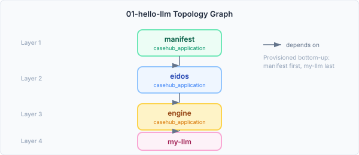
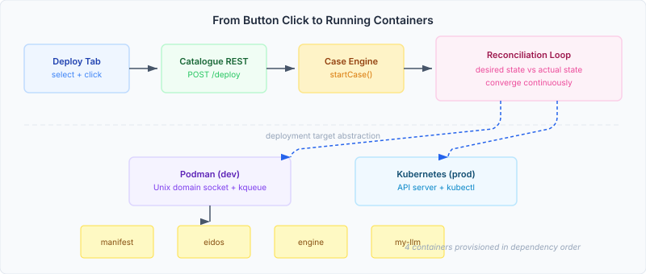

# From Deploy Button to Running Containers

Most deployment tools work imperatively. You write a script, run it, and hope nothing changes while it executes. The topology fails halfway through, you clean up manually, you run it again. Every ops engineer has lived this — the deployment that worked on Tuesday and failed on Wednesday because someone added a volume mount that the script didn't know about.

CaseHub's ops module does something different. A deployment is a desired-state graph. The system doesn't execute steps and finish — it reconciles continuously, converging reality toward the declared topology until the gap is zero. When it detects drift, it doesn't alert and wait. It acts.

This entry is about making that model real enough to click a button and watch containers start.

## Topologies, not containers

The fundamental unit of deployment in CaseHub isn't a container. It's a topology — a directed acyclic graph where nodes are services and edges are dependencies. The `01-hello-llm` topology declares four nodes: a manifest store, an eidos identity service, the CaseHub engine, and an LLM application.



The graph captures something a flat container list doesn't: **order matters, and it's structural**. The manifest store has no dependencies — it goes first. The LLM app depends on engine, which depends on eidos, which depends on manifest. The transition planner reads this graph and produces a layered provisioning plan automatically. You don't hand-write the deploy sequence. You declare what should exist and how it connects.

This distinction matters when things change. Add a node, the planner recalculates. Remove a dependency, the order adjusts. Change a node type from `casehub_application` to `casehub_function`, a different provisioner handles it. The topology is a living document, not a frozen script.

## What the deploy button actually does

The deploy flow crosses five layers in a single button click:



The UI sends a POST to the catalogue REST endpoint. The endpoint does two things atomically: it starts a reconciliation loop with the compiled topology, and it creates a case in the CaseHub engine to track the deployment lifecycle. The case gives you events, milestones, audit — everything the engine provides for any managed process. The reconciliation loop gives you convergence.

The reconciliation loop runs on a timer. Each cycle it reads the desired state (the topology graph) and the actual state (what Podman or Kubernetes reports as running). It diffs the two and takes action: provision missing nodes, remove extras, restart failed ones. The loop doesn't stop after the initial deployment — it keeps running, which is what makes it a reconciliation loop rather than a deploy script.

## The deployment target abstraction

The same reconciliation loop deploys to Podman locally and Kubernetes in production. The abstraction layer is a `DeploymentTarget` interface with three operations: provision, remove, and query actual state. In dev mode, scaffold overrides the target to Podman:

```properties
%dev.casehub.ops.deployment-target-override=podman
%dev.quarkus.vertx.prefer-native-transport=true
```

The Podman target talks to the Podman API over a Unix domain socket — which on macOS means kqueue native transport for Vert.x. That's a detail, but it's the kind of detail that took longer to get right than the actual deployment logic. The socket address, the native transport library, the platform-specific Maven profile — plumbing that has to work before the architecture can prove itself.

## What the E2E verification actually found

We set out to verify one thing: click deploy, watch containers start. What we found was a chain of integration issues spanning five repositories:

**A dead dependency in engine.** `serverlessworkflow-experimental-types` was declared in the Maven BOM but never imported by any Java source file. Version `7.35.3.Final` was never published to Maven Central. Every downstream build — scaffold, ops, anything that consumed engine — failed to resolve it. Zero imports across the entire engine codebase. A dependency that existed only in XML.

**A Podman API format mismatch.** Podman 5.x returns volume listings as a plain JSON array. The client code expected Docker's format — a JSON object with a `"Volumes"` key wrapping the array. One line of response parsing, wrong for every Podman version shipped in the last year. The kind of bug you only find when you actually connect to the thing.

**A CDI augmentation gap.** Quarkus scans the classpath at build time for CDI beans. When a dependency marks a transitive module as `optional`, the types are still referenced — Quarkus tries to resolve them, fails, and silently drops the bean. The fix was adding `casehub-neocortex-annotation-api` to scaffold's classpath. Not because scaffold uses it, but because Quarkus needs to *see* it to wire the beans that do.

None of these bugs were in the deployment code itself. The topology compiler, the transition planner, the reconciliation loop, the Podman provisioner — all worked correctly in isolation. The failures were all at the boundaries: the seams where repositories meet, where API versions diverge, where Maven's dependency model and CDI's classpath model interact in ways neither was designed for.

## Why this architecture matters

The imperative alternative — a script that provisions four containers in order — would have worked on the first try. No reconciliation loop, no case engine, no topology compiler. Faster to build, simpler to debug.

But it would only work once.

The reconciliation model handles the cases that imperative scripts don't: drift detection after deployment, dependency-aware restart ordering, target-agnostic provisioning, and the ability to change the topology without rewriting the deploy logic. A script encodes a specific path through a specific infrastructure at a specific point in time. A topology describes an intent. The reconciliation loop is the mechanism that makes intent durable.

The deploy button is simple. The machinery behind it is not. That's the point — the complexity lives in the platform, not in the operator's head. A topology that works on Podman today deploys to Kubernetes tomorrow with a config change. A topology that provisions four nodes today provisions fourteen the same way.

The gap between "desired" and "actual" is where ops engineering lives. Most tools hand you that gap and wish you luck. A reconciliation loop closes it continuously.
